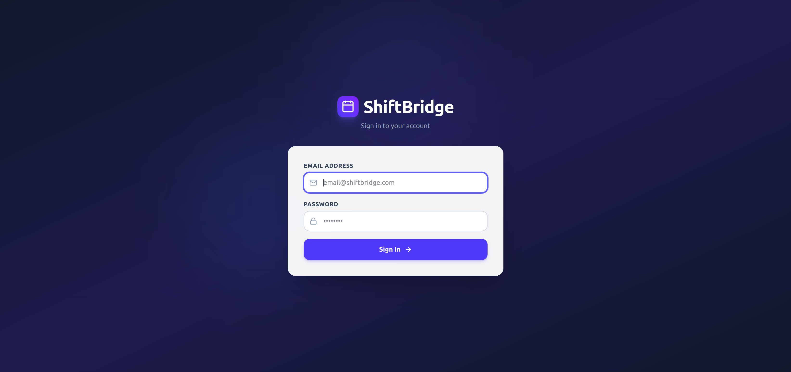
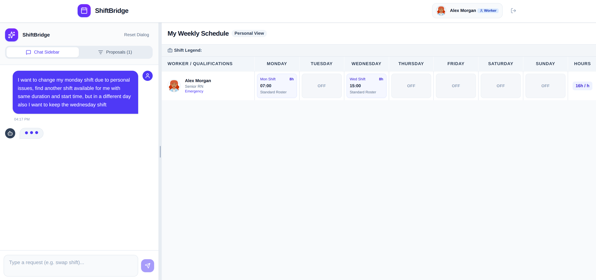
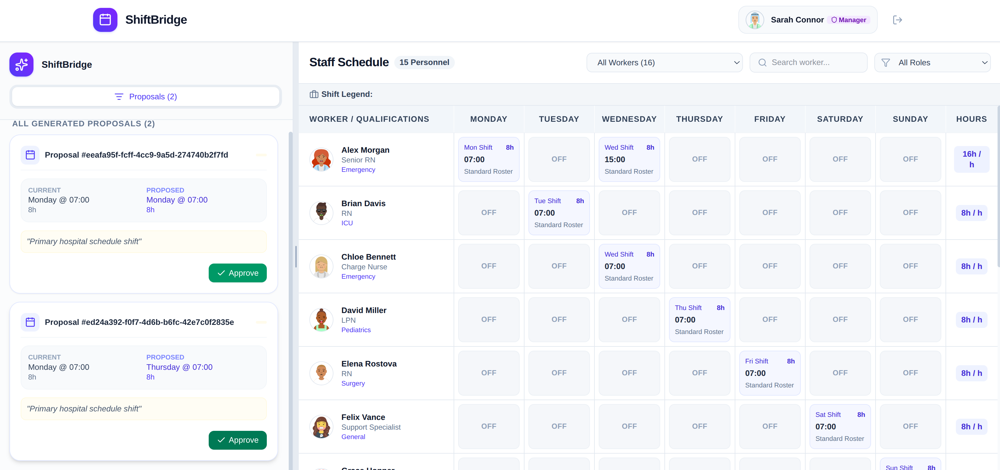
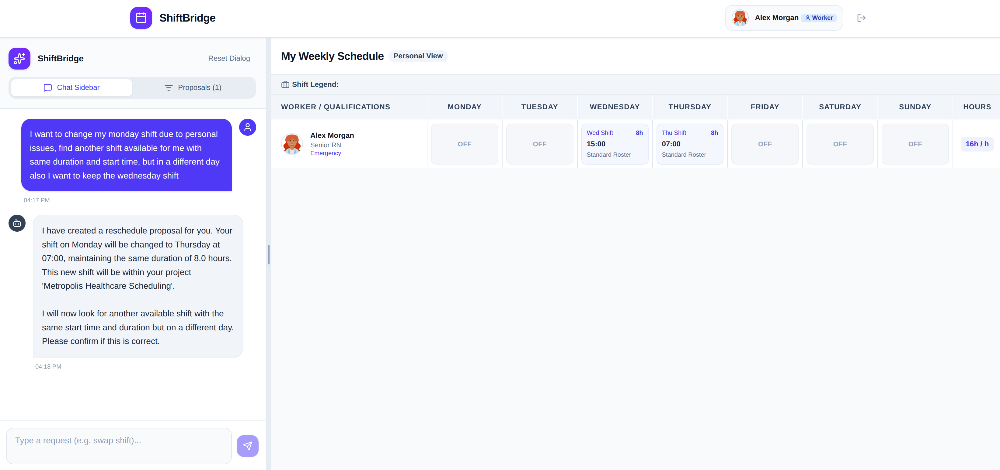

# ShiftBridge: Application Overview & Scheduling Guide

**ShiftBridge** is a full-stack workforce scheduling application that combines an interactive weekly roster with an AI-powered scheduling assistant and a dual-approval workflow. It enables workers to request shift changes conversationally while giving managers full visibility and final sign-off over team schedules.

---

## 1. High-Level Architecture

ShiftBridge is built as a decoupled client-server application:

- **Frontend:** A **React + TypeScript** single-page application styled with **Tailwind CSS** (`App.tsx`, `CalendarGrid.tsx`, `SidebarChat.tsx`, `ProposalCard.tsx`, `AuthCard.tsx`, `Header.tsx`), communicating with the backend via `services/api.ts`.
- **Backend:** A **FastAPI** REST API (`main.py`) backed by **SQLite** via **SQLAlchemy 2.0** (`models.py`, `database.py`), secured with **JWT Bearer authentication** (`auth.py`, `security.py`).
- **AI Engine:** A local LLM integration (`ai_service.py`) using an OpenAI-compatible client with function-calling tools (`tools.py`) to inspect schedules and generate reschedule proposals.

---

## 2. Core Data Entities

The scheduling system revolves around four primary database models:

1. **Worker (`workers`):** Represents staff members and managers. Stores profile details (`name`, `role`, `department`), weekly hour limits (`max_hours`, `current_hours`), and privilege level (`is_manager`).
2. **Project (`projects`):** Groups workers under a supervising manager (`manager_id`). Workers and projects have a many-to-many relationship (`project_workers`).
3. **Shift (`shifts`):** Represents a scheduled work block for a specific `worker_id` and `project_id` on a given `day` (`Monday`–`Sunday`), with `start_time`, `length` (hours), `type` (`regular`, `off`, `updated`, `conflict`), and optional `note` or `updated_by_ai` flags.
4. **Proposal (`proposals`):** Represents a pending shift modification. Stores `worker_id`, a JSON payload (`new_shift_data`) comparing current vs. proposed shift details, and two boolean flags: `isWorkerApproved` and `isManagerApproved`.

---

## 3. How Scheduling Works

### A. Viewing the Weekly Schedule (`CalendarGrid.tsx`)

When a user logs in, the frontend fetches workers, shifts, and proposals in parallel and renders a 7-day (`Monday`–`Sunday`) schedule grid:

- **Worker View:** Displays only the logged-in worker's personal weekly shifts.
- **Manager View:** Displays all staff members (excluding the manager) along with filters for **Worker**, **Search Query** (name, role, or department), and **Role** (`Senior RN`, `Charge Nurse`, `RN`, `LPN`, `Support Specialist`).
- **Weekly Hours Tracking:** Each row calculates the worker's total scheduled hours against their `maxHours` limit, color-coding the badge (indigo for under limit, slate for at limit, rose for overtime).
- **Shift States:**
  - **Standard Roster (`regular`):** Normal scheduled shift.
  - **Day Off (`off`):** Unscheduled day.
  - **Updated via AI (`updated` / `updatedByAi`):** Highlighted in emerald green with an `Approved` badge.
- Clicking any cell opens a detail bar at the bottom of the grid showing the full shift time, duration, and notes.

---

### B. AI-Assisted Rescheduling (`SidebarChat.tsx` → `/chat`)

Workers can request schedule changes through the **Chat Sidebar**:

1. **User Prompt:** The worker types a request (e.g., *"Move my Tuesday shift to Thursday at 09:00 for 8 hours"*). The frontend sends the message and conversation history to `POST /chat`.
2. **AI Tool Calling (`ai_service.py` & `tools.py`):**
   The `LocalLLMShiftAssistant` receives the authenticated worker's context and has access to three database tools:
   - `get_my_shifts`: Inspects the worker's current shifts.
   - `get_other_workers_shifts`: Inspects coworkers' shifts in the same project(s) to check availability and avoid conflicts.
   - `create_reschedule_proposal`: Creates a new `Proposal` record in SQLite with `isWorkerApproved=False` and `isManagerApproved=False`.
3. **Inline Proposal Rendering:** If the AI creates a proposal, it is returned in `created_proposal` and rendered directly inside the chat thread as a `ProposalCard`, showing **Current** vs. **Proposed** day, start time, length, and any notes.

#### The AI Pipeline (Deep Dive)

The AI engine is not a single model call. Because it runs against a **local, lower-capability LLM**, the pipeline is explicitly structured into **three deterministic-orchestrated steps** so that weak model output can never corrupt schedule data. The guiding principle is:

> **The model routes and phrases; Python verifies and executes.** No shift ID, date, or proposal status ever originates from the model — every fact comes from a tool result captured verbatim by the backend.

```
┌─────────────────────────────────────────────────────────────────┐
│                        chat(message, db, user)                  │
└─────────────────────────────────────────────────────────────────┘
                               │
        ┌──────────────────────┼──────────────────────┐
        ▼                      ▼                      ▼
┌───────────────┐    ┌──────────────────┐    ┌──────────────────┐
│ STEP 1        │    │ STEP 2           │    │ STEP 3           │
│ Hint          │    │ Bounded Tool     │    │ Grounded Message │
│ Extraction    │───▶│ Loop             │───▶│ Formatting       │
│ (Python)      │    │ (LLM + tools)    │    │ (LLM + facts)    │
└───────────────┘    └──────────────────┘    └──────────────────┘
        │                      │                      │
        ▼                      ▼                      ▼
  regex entities       tools_executed[]        final reply text
  (shift_id, length,   + created_proposal      grounded in
   date_str)                                      verified results
```

**Step 1 — Hint Extraction (deterministic, no LLM).**
`extract_entities_fallback(text)` runs regexes over the raw user message to pull out anything explicitly stated: `shift_id` (e.g. "shift #42"), `project_id`, `length` (e.g. "for 6 hours", "8-hour shift"), and ISO-style `date_str`. These hints are appended to the message sent to the model as a bracketed suffix (`[Extracted hints from text: {...}]`), giving a weak model a second chance to notice explicit IDs it might otherwise drop. Hints are also used later by `_normalize_tool_args` to backfill missing tool arguments. The caller's `chat_history` is never mutated.

**Step 2 — Bounded Tool Loop.**
The model is called with `tools=OPENAI_TOOLS` and `tool_choice="auto"`, up to `max_tool_steps` times (5). Each iteration: call the model; save any `content` as a `draft_reply` (a phrasing hint only, not trusted as fact); if there are no `tool_calls`, stop; otherwise parse each tool call's arguments (`json.loads`, falling back to `{}` on error), normalize them (backfill `shift_id`/`length` from Step-1 hints, coerce `length` to float), execute via `tools.execute_tool_by_name(...)` with the DB session and current user ID, append `{tool, arguments, result}` to `tools_executed`, capture `created_proposal_data` on a successful proposal, and feed the result back as a `role: "tool"` message so the model can reason on the next turn. The loop terminates on: no tool calls, step limit reached, or exception.

The **tool router prompt** is what makes this work with a small model. It states the capability gap ("You do NOT know any schedules… You MUST call tools"), maps intent to each tool, and — critically — prescribes the reschedule order: **(A)** resolve the shift (use a provided `shift_id`, else `get_my_shifts`), **(B)** optionally gather candidates via `get_other_workers_shifts` if coverage is asked, **(C)** call `create_reschedule_proposal` with the resolved `shift_id` and `length`, **(D)** stop and summarize. It also enforces hard guards: never invent IDs, never call the proposal tool without a `shift_id`, never repeat an identical call, and no blind retries.

**Step 3 — Grounded Message Formatting.**
`_format_final_message` first builds a **deterministic summary** of every tool result (`_build_verified_facts_summary`), then asks the model to rewrite that summary into a short user-facing reply under strict rules: only facts present in the summary, explicitly say **"not completed"** if the proposal failed, no tool names, no JSON, no invented alternatives, 1–3 sentences. The formatter prompt is domain-aware and distinguishes four outcomes — proposal **succeeded** (confirm, cite shift ID and details), proposal **failed** (say it was not completed and give the reason), tools only **gathered data** (summarize and ask the user to confirm the target), and **no shift identified** (ask for the ID or date). If the formatter call fails or returns empty, the pipeline **falls back to the deterministic summary itself**, so the user always receives an accurate — if less polished — answer. If no tools ran at all, the cleaned `draft_reply` is returned directly.

**End-to-end reschedule example.**
User: *"Reschedule my 8-hour shift tomorrow to something else."*
Step 1 extracts `length = 8.0` (no `shift_id` stated). Step 2 iteration 1 calls `get_my_shifts` → returns shift ID `42`; iteration 2 optionally calls `get_other_workers_shifts` for candidates; iteration 3 calls `create_reschedule_proposal(shift_id=42, length=8)` → `{"success": true, "proposal": {...}}`; iteration 4 returns content with no tool calls and the loop breaks. Step 3 sees `SUCCEEDED` and replies: *"Your 8-hour shift on 2025-03-14 (ID 42) has been submitted for reschedule. Proposal #… created."*

**Return contract.** `chat()` returns `{"reply": str, "tools_used": [{tool, arguments, result}, ...], "created_proposal": dict | None}`. The `tools_used` list is a full audit trail in execution order; `created_proposal` is populated only when a proposal succeeded. On an unhandled exception the pipeline returns `{"reply": "Error", "tools_used": [], "created_proposal": None}` and logs the traceback.

**Configuration & reliability notes.** Base URL, API key, and model name come from `OPENAI_BASE_URL` / `OPENAI_API_KEY` / `LOCAL_LLM_MODEL` env vars (falling back to `settings`). The client and per-call timeouts are both `httpx.Timeout(215.0, connect=3.0)` — **a short client-level timeout (the original 1.5s) preempts the per-call value and causes near-constant silent failures on a local model**. `max_tool_steps` is 5 (3 is too tight to complete resolve → gather → propose → summarize), `max_history_turns` is 8, and `max_retries` is 0. `<think>...</think>` reasoning blocks are stripped from all model text by `_clean_model_text` before it reaches the user. The module exposes a singleton, `ai_engine = LocalLLMShiftAssistant()`.

---

### C. Dual-Approval Workflow (`ProposalCard.tsx` → `POST /data/approve`)

A shift change is **not** applied to the live schedule until **both** the worker and their supervising manager approve it:

1. **Viewing Proposals:**
   - Workers see their own proposals in the chat thread or the **Proposals** tab.
   - Managers see all pending proposals for workers assigned to projects they manage.
2. **Recording an Approval:**
   - Clicking **Approve** sends `proposal_id` to `POST /data/approve`.
   - The backend verifies authorization:
     - If the caller is the proposal's `worker_id`, `isWorkerApproved` is set to `True`.
     - If the caller is a manager of a project the worker belongs to, `isManagerApproved` is set to `True`.
     - Otherwise, a `403 Forbidden` error is returned.
3. **Partial Approval:**
   - If only one party has approved, the proposal remains in the database (`deleted: false`) and updates the UI to show **Approved** for that party while waiting on the other.
4. **Full Approval (Both Parties):**
   - Once both `isWorkerApproved` and `isManagerApproved` are `True`:
     - The backend extracts `new_shift_data` and updates the existing `Shift` (or creates a new one if no `shift_id` exists).
     - The `Proposal` record is **deleted** from the database (`deleted: true`).
     - The frontend removes the proposal from the **Proposals** list and chat thread, and immediately updates the `CalendarGrid` state with `result.new_shift`.

---

## 4. Authentication & Role Detection

- Users sign in via `AuthCard.tsx` (`POST /auth/login`), which returns a JWT stored in `localStorage` (`jwt`).
- All protected API calls attach `Authorization: Bearer <token>`.
- On load, `App.tsx` calls `GET /auth/me` to restore the session and determines whether to render the **Worker** or **Manager** interface.

---

## 5. Tech Stack

**Backend**

- **Framework:** FastAPI
- **Database / ORM:** SQLite & SQLAlchemy 2.0
- **Validation:** Pydantic v2
- **AI / LLM Integration:** `openai` Python SDK (OpenAI-compatible local LLM endpoint with Tool Calling)
- **Testing:** Pytest & Starlette TestClient

**Frontend**

- **Framework:** React (with Hooks)
- **Language:** TypeScript
- **Styling:** Tailwind CSS
- **Icons:** `lucide-react`
- **State & Routing:** Local React state + `window.history.pushState` / `popstate` (for `/login` and `/dashboard`)
- **Authentication:** JWT stored in `localStorage` (`jwt`)

---

## 6. Setup & Run Instructions

### Prerequisites

- Python 3.10 or higher
- Node.js 18+ and npm (for the frontend)
- (Optional) Local LLM runner such as [Ollama](https://ollama.com/), [LM Studio](https://lmstudio.ai/), or vLLM

### Backend Setup

```bash
# 1. Create and activate a virtual environment
python3 -m venv venv
source venv/bin/activate        # Linux/macOS
# venv\Scripts\activate         # Windows

# 2. Install dependencies
pip install -r requirements.txt
```

Create or modify your `.env` file in the root directory (refer to `.env.example`):

```ini
APP_NAME="ShiftBridge API"
DEBUG_MODE=true
DATABASE_URL="sqlite:///./shiftbridge.db"
SECRET_KEY="your-secure-jwt-secret-key"

# Local LLM settings (OpenAI-compatible endpoint)
LOCAL_LLM_BASE_URL="http://localhost:11434/v1"
LOCAL_LLM_API_KEY="ollama"
LOCAL_LLM_MODEL="llama3.2"
```

> **Note on Local LLMs:** If you are using Ollama, ensure your model is pulled:
>
> ```bash
> ollama pull llama3.2
> # or
> ollama pull qwen2.5
> ```

### Database Seeding

Seed the database with **1 manager**, **15 workers in one project**, and **15 upcoming scheduled shifts**:

```bash
python seed.py
```

To reset and re-seed the database:

```bash
python seed.py --reset
```

#### Sample Seeded Credentials

| Role                | Email                        | Password        | Details                        |
| ------------------- | ---------------------------- | --------------- | ------------------------------ |
| **Manager**   | `manager@shiftbridge.com`  | `password123` | Sarah Connor (Project Manager) |
| **Worker 1**  | `worker1@shiftbridge.com`  | `password123` | Alex Morgan                    |
| **Worker 2**  | `worker2@shiftbridge.com`  | `password123` | Brian Davis                    |
| ...                 | ...                          | ...             | ...                            |
| **Worker 15** | `worker15@shiftbridge.com` | `password123` | Olivia Martinez                |

### Running the Backend

```bash
uvicorn main:app --reload --host 0.0.0.0 --port 8000
```

Once running:

- **API Root:** http://localhost:8000/
- **Interactive Swagger UI:** http://localhost:8000/docs
- **ReDoc:** http://localhost:8000/redoc

### Running the Frontend

The frontend communicates with the backend at `http://localhost:8000` (configured in `services/api.ts`). Start the React dev server from the frontend directory:

```bash
npm install
npm run dev
```

Then open the URL printed by Vite (typically http://localhost:5173) and sign in with a seeded credential.

### Running Automated Tests

```bash
pytest          # full suite
pytest -v       # verbose
```

The test suite covers:

- User signup, duplicate validation, login, and JWT authentication (`tests/test_auth.py`)
- Project and Shift model creation, many-to-many worker assignment, relationships, and cascading deletes (`tests/test_models.py`)
- AI Chat endpoints, OpenAI tool calling round-trip, multi-turn reschedule, and direct shift APIs (`tests/test_chat_and_tools.py`)
- Data seeding script verification and idempotency (`tests/test_seed.py`)

---

## 7. API Endpoints Overview

### Authentication (`/auth`)

- `POST /auth/signup` - Register a new worker account
- `POST /auth/login` - Authenticate and receive a JWT Bearer access token
- `GET /auth/me` - Retrieve current authenticated user profile

### AI Chat & Tools (`/chat`)

- `POST /chat` - Natural language chat with the local LLM to reschedule shifts or inspect coworker schedules
  ```json
  {
    "message": "Can you show me other workers' shifts and reschedule my shift on project 1 to 2026-11-20 09:00?",
    "history": []
  }
  ```
- `GET /chat/tools` - Exposes OpenAI-compatible tool schemas (`get_other_workers_shifts`, `reschedule_shift`, `get_my_shifts`)
- `POST /chat/tools/execute` - Directly invoke a tool by name with arguments

### Shifts (`/shifts`)

- `GET /shifts/my-shifts` - List current user's shifts
- `GET /shifts/project/{project_id}/workers` - List other workers' shifts in a project
- `PATCH /shifts/{shift_id}/reschedule` - Directly reschedule a shift

### Data (`/data`)

- `GET /data/workers` - List workers (manager view)
- `GET /data/schedule` - Fetch weekly schedule
- `GET /data/proposals` - List pending proposals
- `POST /data/approve` - Record a worker or manager approval for a proposal

---

## 8. Deploying ShiftBridge to Google Cloud Run

This section explains how to deploy the ShiftBridge API to **Google Cloud Run** using the provided `Dockerfile`.

### 8.1 Prerequisites

- A Google Cloud project with billing enabled
- [Google Cloud SDK (`gcloud`)](https://cloud.google.com/sdk/docs/install) installed and authenticated
- Docker installed locally (optional, for local image testing)
- Enable the required APIs:

```bash
gcloud services enable run.googleapis.com \
  artifactregistry.googleapis.com \
  cloudbuild.googleapis.com
```

### 8.2 How the Dockerfile Fits Cloud Run

The provided `Dockerfile` is already Cloud Run–ready:

| Dockerfile Instruction                                                                                                                                                                                                                                                                                                                                                                                                                                                                                            | Why It Matters on Cloud Run                                                                              |
| ----------------------------------------------------------------------------------------------------------------------------------------------------------------------------------------------------------------------------------------------------------------------------------------------------------------------------------------------------------------------------------------------------------------------------------------------------------------------------------------------------------------- | -------------------------------------------------------------------------------------------------------- |
| `FROM python:3.12-slim`                                                                                                                                                                                                                                                                                                                                                                                                                                                                                         | Lightweight base image reduces cold-start time and image size.                                           |
| `WORKDIR /app` + `COPY requirements.txt` first                                                                                                                                                                                                                                                                                                                                                                                                                                                                | Leverages Docker layer caching so dependency installs are only re-run when `requirements.txt` changes. |
| `RUN pip install --no-cache-dir -r requirements.txt`                                                                                                                                                                                                                                                                                                                                                                                                                                                            | `--no-cache-dir` keeps the image small (no pip cache layer).                                           |
| `RUN useradd --create-home --uid 10001 appuser` + `USER appuser`                                                                                                                                                                                                                                                                                                                                                                                                                                              | Runs the container as a non-root user — a Cloud Run security best practice.                             |
| `CMD exec uvicorn main:app --host 0.0.0.0 --port ${PORT:-8080} --workers 1` | **Critical:** Cloud Run injects a `PORT` environment variable at runtime. The shell form expands `${PORT}`, and `exec` ensures Uvicorn receives `SIGTERM` directly for graceful shutdown during scale-down. Binding to `0.0.0.0` is required so Cloud Run's front end can reach the container. `--workers 1` is recommended because Cloud Run scales horizontally by container instances, not worker processes. |                                                                                                          |

> **Note on SQLite:** Cloud Run containers have an **ephemeral filesystem**. The default `DATABASE_URL="sqlite:///./shiftbridge.db"` will not persist across revisions or instances. For production, switch to a managed database (e.g., Cloud SQL for PostgreSQL) and update `DATABASE_URL` accordingly. For a quick demo, the in-container SQLite file works but resets on each new instance.

### 8.3 Configure Environment Variables

Cloud Run does not read your local `.env` file. Pass configuration via `--set-env-vars` or `--set-secrets`:

```bash
# Minimum required runtime variables
gcloud run deploy shiftbridge-api \
  --set-env-vars="APP_NAME=ShiftBridge API,DEBUG_MODE=false,DATABASE_URL=sqlite:///./shiftbridge.db,LOCAL_LLM_BASE_URL=http://localhost:11434/v1,LOCAL_LLM_MODEL=llama3.2"
```

For sensitive values such as `SECRET_KEY` and `LOCAL_LLM_API_KEY`, use **Secret Manager** instead of plain env vars:

```bash
# Store the secret
echo -n "your-secure-jwt-secret-key" | \
  gcloud secrets create SHIFTBRIDGE_SECRET_KEY --data-file=-

# Grant the Cloud Run service account access
gcloud secrets add-iam-policy-binding SHIFTBRIDGE_SECRET_KEY \
  --member="serviceAccount:YOUR_PROJECT_NUMBER-compute@developer.gserviceaccount.com" \
  --role="roles/secretmanager.secretAccessor"

# Reference it at deploy time
gcloud run deploy shiftbridge-api \
  --set-secrets="SECRET_KEY=SHIFTBRIDGE_SECRET_KEY:latest"
```

> **Local LLM caveat:** `LOCAL_LLM_BASE_URL="http://localhost:11434/v1"` points to Ollama running on the *same machine*. On Cloud Run, `localhost` refers to the container itself, so the LLM endpoint will be unreachable. Options:
>
> - Deploy your LLM (e.g., vLLM on a Cloud Run GPU service or GKE) and set `LOCAL_LLM_BASE_URL` to its URL.
> - Rely on the built-in **resilient fallback engine** described above, which keeps chat endpoints functional when the LLM is unavailable.

### 8.4 Build & Deploy

#### Option A — Deploy from source (Cloud Build builds the image for you)

Run from the repository root containing the `Dockerfile`:

```bash
gcloud run deploy shiftbridge-api \
  --source . \
  --region=us-central1 \
  --allow-unauthenticated \
  --port=8080 \
  --memory=512Mi \
  --cpu=1 \
  --min-instances=0 \
  --max-instances=5 \
  --timeout=300
```

- `--source .` triggers Cloud Build to build the `Dockerfile` and push to Artifact Registry automatically.
- `--allow-unauthenticated` makes the API publicly reachable (remove for private/internal APIs and use IAM).
- `--min-instances=0` allows scale-to-zero (cold starts may occur; set to `1` to keep it warm).
- `--port=8080` matches the `PORT` default in the Dockerfile; Cloud Run overrides it via the `${PORT}` expansion.
- `--timeout=300` allows up to 5 minutes per request — useful if the local LLM call is slow.

#### Option B — Build with Docker, push to Artifact Registry, then deploy

```bash
# 1. Create a repository (one-time)
gcloud artifacts repositories create shiftbridge \
  --repository-format=docker \
  --location=us-central1

# 2. Authenticate Docker to Artifact Registry
gcloud auth configure-docker us-central1-docker.pkg.dev

# 3. Build and push
export IMAGE=us-central1-docker.pkg.dev/PROJECT_ID/shiftbridge/api:latest
docker build -t $IMAGE .
docker push $IMAGE

# 4. Deploy
gcloud run deploy shiftbridge-api \
  --image=$IMAGE \
  --region=us-central1 \
  --allow-unauthenticated \
  --port=8080
```

### 8.5 Run Database Seeding (Optional, Demo Only)

Because the container filesystem is ephemeral, seeding must happen at runtime. Two approaches:

1. **Seed on container start** — add a startup command that runs `python seed.py` before Uvicorn (e.g., override `CMD` with a small entrypoint script). Be aware this re-seeds on every cold start.
2. **Use a persistent database** — migrate to Cloud SQL, then run `python seed.py` once from a Cloud Run Job or a temporary VM pointed at the same `DATABASE_URL`.

Example Cloud Run Job for seeding against Cloud SQL:

```bash
gcloud run jobs create shiftbridge-seed \
  --image=$IMAGE \
  --region=us-central1 \
  --set-env-vars="DATABASE_URL=postgresql+psycopg://user:pass@/shiftbridge?host=/cloudsql/PROJECT_ID:us-central1:shiftbridge-db" \
  --set-cloudsql-instances=PROJECT_ID:us-central1:shiftbridge-db \
  --command="python" --args="seed.py"

gcloud run jobs execute shiftbridge-seed --region=us-central1
```

### 8.6 Verify the Deployment

```bash
# Get the service URL
gcloud run services describe shiftbridge-api \
  --region=us-central1 \
  --format='value(status.url)'
```

Then check:

- `GET https://YOUR_SERVICE_URL/` — API root
- `GET https://YOUR_SERVICE_URL/docs` — Swagger UI
- `POST https://YOUR_SERVICE_URL/auth/login` with seeded credentials (if seeded)

View logs:

```bash
gcloud run services logs read shiftbridge-api --region=us-central1
```

### 8.7 Updating the Service

Re-run the deploy command after code changes. Cloud Run creates a new revision, shifts traffic, and keeps the previous revision available for rollback:

```bash
gcloud run deploy shiftbridge-api --source . --region=us-central1

# Roll back to a prior revision if needed
gcloud run services update-traffic shiftbridge-api \
  --region=us-central1 \
  --to-revisions=shiftbridge-api-00001-abc=100
```

### 8.8 Production Checklist

- [ ] Replace SQLite with Cloud SQL (PostgreSQL) and update `DATABASE_URL`
- [ ] Store `SECRET_KEY` and `LOCAL_LLM_API_KEY` in Secret Manager
- [ ] Set `DEBUG_MODE=false` in production
- [ ] Point `LOCAL_LLM_BASE_URL` at a reachable LLM service (or accept fallback behavior)
- [ ] Configure a dedicated service account with least-privilege IAM
- [ ] Add `--min-instances=1` if cold starts are unacceptable
- [ ] Enable Cloud Run health checks / readiness if adding long LLM timeouts
- [ ] Set up Cloud Monitoring alerts on 5xx rates and latency

---

## 9. ScreenShots










## 10. Future Ideas

The current implementation is intentionally scoped to a single-project, weekly-roster demo. The following enhancements would move ShiftBridge toward a production-ready workforce management platform:

### AI & Scheduling Intelligence

- **Multi-project scheduling:** Extend the AI tools to reason across all projects a worker belongs to, resolving cross-project conflicts rather than assuming one project.
- **Constraint-aware proposals:** Add tools for skills/certifications, union rules, rest-period enforcement, and consecutive-day limits so proposals are validated against policy before reaching the manager.
- **Conflict auto-resolution:** When a proposal creates a coverage gap, have the AI suggest alternative workers or times, presenting 2–3 ranked options instead of a single proposal.
- **Natural-language roster generation:** Let managers describe a week ("cover nights with two RNs, no one over 40 hours") and generate a draft roster for review.
- **Streaming responses:** Stream the grounded formatting step token-by-token via SSE/WebSocket so users see partial replies during slow local LLM calls.
- **Model-agnostic evaluation harness:** A golden-set of prompts with expected tool-call traces to regression-test prompt changes across Llama, Qwen, Mistral, etc.

### Workflow & Collaboration

- **Bulk approvals:** Manager actions to approve/reject multiple proposals at once, with a diff view of the affected week.
- **Rejection with reason:** Add a `rejected` state and free-text reason to proposals, surfaced back to the worker in the chat thread.
- **Notifications:** Email/Slack/push notifications when a proposal is created, partially approved, fully approved, or rejected.
- **Audit log:** Immutable record of every shift change, approval, and AI tool call for compliance and dispute resolution.
- **Shift swaps:** Support two-worker swap proposals, requiring three-party approval (worker A, worker B, manager).
- **Time-off requests:** A dedicated request type that feeds into the same approval workflow and blocks conflicting proposals.

### Platform & Data

- **PostgreSQL + Alembic migrations:** Replace SQLite with Postgres for multi-instance Cloud Run deployments, and introduce versioned schema migrations.
- **Multi-tenancy:** Organization/hospital scoping with row-level isolation.
- **Role-based access control:** Replace the `is_manager` boolean and `user.id.startsWith('m')` check with proper roles (admin, manager, scheduler, worker) and per-project scoping.
- **Calendar integrations:** Two-way sync with Google Calendar / Outlook (iCal export at minimum).
- **Mobile-responsive / PWA:** Installable mobile experience with offline viewing of the current week's roster.
- **i18n & timezone handling:** Store shifts in UTC with per-worker timezone rendering; localize UI strings.

### Engineering & Operations

- **CI/CD:** GitHub Actions pipeline running `pytest`, frontend lint/typecheck, Docker build, and automated Cloud Run deploys on merge to `main`.
- **Observability:** Structured JSON logging, OpenTelemetry traces across FastAPI → LLM → DB, and dashboards for LLM latency/error rates and tool-call success rates.
- **Rate limiting & quotas:** Per-user limits on `/chat` to protect a shared local LLM from runaway usage.
- **Prompt/version management:** Externalize the router and formatter prompts into versioned config so they can be tuned without code deploys.
- **End-to-end tests:** Playwright tests covering login → chat → proposal → dual approval → grid update.
- **Frontend state management:** Replace prop-drilled state in `App.tsx` with React Query (server state) plus a lightweight store (UI state) as the app grows.
